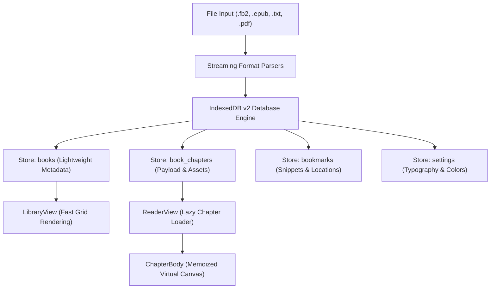

# Bookera

> **Offline Android Reader**: High-performance offline light novel and book reader for Android engineered with RanobeLib-inspired reading ergonomics, stream-based multi-format parsing, smart chapter detection, and customizable reading palettes.

[](https://developer.android.com)
[](https://react.dev)
[](https://www.typescriptlang.org)
[](https://capacitorjs.com)
[](https://tailwindcss.com)
[](https://vitejs.dev)
[](https://developer.mozilla.org/en-US/docs/Web/API/IndexedDB_API)
[](LICENSE)

---

## Application Preview


*Bookera reading canvas featuring AMOLED dark background (#0a0a0a), soft typography (#bdbdbd), top status bar spacer shield, floating navigation controls, and side-by-side RanobeLib ergonomic alignment.*

---

## Table of Contents

- [Application Preview](#application-preview)
- [Overview](#overview)
- [Design Philosophy](#design-philosophy)
- [Key Features](#key-features)
- [Architecture and Storage Engine](#architecture-and-storage-engine)
- [Technology Stack](#technology-stack)
- [Repository Structure](#repository-structure)
- [Installation and Development Setup](#installation-and-development-setup)
- [Android Build and APK Compilation](#android-build-and-apk-compilation)
- [Chronological Project History](#chronological-project-history)
- [Security and Data Privacy](#security-and-data-privacy)
- [License and Author](#license-and-author)

---

## Overview

Bookera is an offline-first reading platform and native Android client built specifically for light novels, web serials, and long-form e-books. Mainstream reader applications often force heavy cloud logins, synchronize reading data with external servers, or lack the responsive typography, spacing, and chapter navigation controls popularized by specialized online novel platforms like RanobeLib.

Bookera bridges this gap by delivering a lightweight single-page application wrapped in a native Capacitor Android container. The entire application operates 100% locally on device storage without internet access requirements, advertising SDKs, or background telemetry.

---

## Design Philosophy

- **RanobeLib Reading Ergonomics**: Clean text-first presentation with floating top app bars and bottom control drawers that toggle on screen tap or directional scrolling.
- **Calibrated Color Reproduction**: Default AMOLED Dark theme precision-tuned to `#0a0a0a` background and `#bdbdbd` text luminance, avoiding excessive contrast while matching mobile web rendering pixel-by-pixel.
- **Top Notch and Punch-Hole Shielding**: A dedicated status bar spacer (`TopStatusBarSpacer`) safeguards reading text from being obscured under front camera cutouts and curved displays.
- **Zero Memory Exhaustion**: Heavy books containing hundreds of embedded illustrations (such as 190 MB FB2 archives) are parsed through streaming regular expressions rather than monolithic browser DOM trees, preventing browser crashes.
- **Strictly No Emojis**: Minimalist, professional interface designed exclusively with vector Lucide icons.

---

## Key Features

### 1. High-Performance Format Parsers
- **Stream-Based FB2 Parser**: Processes FictionBook 2.0 files up to 200 MB in under 1 second. Embedded Base64 binary assets are extracted on the fly and mapped strictly to the individual chapters in which they appear, minimizing memory footprint.
- **Smart Chapter Detection**: Instead of relying solely on unnested `<section>` tags (which Calibre and converters frequently collapse), Bookera scans paragraph headings using regex patterns (`Глава [0-9]+: ...`) to accurately restore 100+ original novel chapters.
- **EPUB Archive Parser**: Built upon JSZip and asynchronous DOM extraction to stream zipped XHTML contents with cancellation tokens.
- **Plain Text (TXT) Splitter**: Automatically parses monolithic text documents into chapter chunks based on recognized headings and numbering markers.
- **PDF Text Extractor**: Integrated with Mozilla `pdfjs-dist` to extract pure readable text streams while retaining reading progress.
- **Universal File Picker**: Handles Android MIME limitations by utilizing universal file selection (`*/*`) and validating `.fb2`, `.fb2.zip`, `.epub`, `.txt`, and `.pdf` extensions on the client side.

### 2. Typography and Canvas Controls
- **Interactive Color Palette Pickers**: Full customization for canvas background and font colors. Features both native mobile color swatch pickers and direct HEX input fields with automatic `#` prefixing and input normalization.
- **Preconfigured Theme Presets**: Includes White, Light Gray, Sepia, Beige Parchment, Slate Charcoal, and AMOLED Dark.
- **Font Family Selection**: System default, Classic Serif, PT Serif / Merriweather, Georgia, Sans-Serif, and Monospace.
- **Fine-Grained Adjustments**:
  - Font size (12px to 32px)
  - Line height multiplier (1.0 to 2.5)
  - Paragraph spacing (0px to 30px)
  - Container content width (70% to 100%)
  - Side edge margins toggle
  - Text alignment (Left aligned or Justified)
  - Menu trigger mode (Tap or Scroll)

### 3. Fullscreen Image Viewer with Pinch-to-Zoom
- **Modal Overlay**: Tapping on any illustration in the text opens an isolated fullscreen viewing canvas without triggering reader menu bars.
- **Touch Gestures**:
  - Pinch-to-zoom scaling from 100% up to 500%.
  - Double-tap toggle between 100% and 250% zoom.
  - Single-finger panning across enlarged illustrations.
- **Control Toolbar**: Status badge displaying current scale percentage, zoom in/out triggers, reset button, and quick close.

### 4. Bookmarks and Chapter Navigation
- **Paragraph-Specific Bookmarks**: Created via top bar button or double-tapping any paragraph directly on the reading canvas.
- **Deduplication Guard**: Enforces strict unique constraints on `(chapterId, paragraphIndex)` pairs and utilizes in-flight mutation locks to prevent accidental duplicate bookmarks during rapid clicking.
- **Table of Contents Drawer**: Searchable sidebar indexing all book chapters with instantaneous scroll-to-current indicators.
- **Enlarged End-of-Chapter Buttons**: Generous two-column touch targets for "Previous" and "Next" chapter switches placed at the conclusion of every chapter.

---

## Architecture and Storage Engine

Bookera utilizes an IndexedDB v2 architecture that completely decouples book metadata from heavy chapter payloads:



### IndexedDB Object Stores:
1. **`books`**: Stores book id, title, author, cover URL, format, chapter count, current reading progress, and timestamp. Stripped of raw chapter content to ensure sub-millisecond library queries.
2. **`book_chapters`**: Contains isolated arrays of chapters and localized Base64 images. Loaded into memory only when the user enters the reader view.
3. **`bookmarks`**: Indexed by `by-book` with compound uniqueness checks.
4. **`settings`**: User reading preferences and migration flags.

---

## Technology Stack

| Layer | Technology | Purpose |
| --- | --- | --- |
| Runtime Platform | Capacitor 7 | Native Android bridge, status bar handling, file access |
| UI Framework | React 19 + TypeScript | Component tree, hooks, typing, and memoization |
| Build Tool | Vite 6 | Rapid Hot Module Replacement and production bundling |
| Styling | Tailwind CSS 3 | Utility-first styling, CSS custom properties, safe-area insets |
| Client Database | IndexedDB via `idb` | Structured offline persistence with multi-store transactions |
| Archive Engine | JSZip | Extraction of EPUB files and `.fb2.zip` compressed packages |
| PDF Engine | PDF.js (`pdfjs-dist`) | Client-side text extraction from PDF documents |
| Vector Icons | Lucide React | Clean, minimalist SVG icons |

---

## Repository Structure

```
Bookera/
|-- android/                         # Capacitor native Android Gradle project
|   |-- app/
|   |   |-- src/main/
|   |   |   |-- AndroidManifest.xml
|   |   |   |-- java/
|   |   |   `-- res/values/styles.xml
|   |   `-- build.gradle
|   `-- variables.gradle
|-- public/                          # Static public assets
|-- screenshots/                     # Application screenshots and previews
|   `-- photo_2026-10-31_20-14-22.jpg
|-- src/
|   |-- components/
|   |   |-- UI/
|   |   |   |-- SegmentedControl.tsx
|   |   |   |-- Slider.tsx
|   |   |   `-- Toggle.tsx
|   |   |-- BookmarksDrawer.tsx
|   |   |-- DeleteConfirmModal.tsx
|   |   |-- ImageViewerModal.tsx     # Fullscreen pinch-to-zoom image viewer
|   |   |-- LibraryView.tsx          # Bookshelf grid and search
|   |   |-- RanobeSettingsModal.tsx  # Typography and color settings modal
|   |   |-- ReaderView.tsx           # Reading engine canvas and floating bars
|   |   |-- TableOfContentsDrawer.tsx# Searchable chapter list
|   |   `-- TopStatusBarSpacer.tsx   # Camera notch shield spacer
|   |-- services/
|   |   |-- parsers/
|   |   |   |-- epubParser.ts        # EPUB streaming parser
|   |   |   |-- fb2Parser.ts         # High-speed regex FB2 parser
|   |   |   |-- pdfParser.ts         # PDF text extraction
|   |   |   `-- txtParser.ts         # Plain text chapter splitter
|   |   |-- sampleNovel.ts           # Bundled offline sample novel
|   |   `-- storage.ts               # IndexedDB v2 data abstraction layer
|   |-- types/
|   |   `-- book.ts                  # Core TypeScript interfaces and defaults
|   |-- App.tsx                      # Root component and state orchestrator
|   |-- index.css                    # Tailwind CSS directives and dark baseline
|   `-- main.tsx                     # React application entry point
|-- capacitor.config.json            # Capacitor bridge configuration
|-- index.html                       # HTML5 entry with mobile meta tags
|-- package.json                     # NPM project metadata and scripts
|-- preview.jpg                      # Preview image for repository documentation
|-- tailwind.config.js               # Tailwind design system configuration
|-- tsconfig.json                    # TypeScript compiler configuration
`-- vite.config.ts                   # Vite bundler configuration
```

---

## Installation and Development Setup

### Prerequisites
- Node.js 18.x or 20.x
- NPM 9.x or later
- Android Studio / Android SDK 34 (for Android builds)
- OpenJDK 17

### 1. Clone the repository
```bash
git clone https://github.com/zalevskyvova/Bookera.git
cd Bookera
```

### 2. Install dependencies
```bash
npm install
```

### 3. Start local development server
```bash
npm run dev
```
Open your browser at `http://localhost:3000` to inspect the desktop preview.

---

## Android Build and APK Compilation

Bookera uses Capacitor to synchronize built web assets into the Android native wrapper.

### 1. Build the production web bundle
```bash
npm run build
```

### 2. Synchronize assets with the Android project
```bash
npx cap copy android
```

### 3. Compile the debug APK via Gradle
```powershell
# Set Java 17 and Android SDK environment variables
$env:JAVA_HOME = "$env:USERPROFILE\.jdks\jdk17\jdk-17.0.20.1+1"
$env:ANDROID_HOME = "$env:LOCALAPPDATA\Android\Sdk"

# Build debug APK
cd android
.\gradlew.bat assembleDebug
```

The resulting package will be generated at:
```
android/app/build/outputs/apk/debug/app-debug.apk
```

---

## Chronological Project History

### October 2026

- **2026-10-31: Project Inception and Core Reading Engine**
  - Scaffolded React 19 + TypeScript + Vite + Tailwind CSS architecture.
  - Implemented RanobeLib visual layout featuring top app bar, bottom navigation bar, and dark theme baseline.
  - Built IndexedDB v1 storage engine for books, bookmarks, and settings.
  - Created bundled demo novel (Re:Zero Arc 7) for immediate verification.

- **2026-10-31: Android 14 (API 34) Compatibility and Native Gradle Setup**
  - Configured Capacitor 7 Android bridge with compileSdk 34 and targetSdk 34.
  - Resolved Java 25 compatibility barrier by adopting OpenJDK 17.
  - Adjusted AndroidX dependency matrix to support compileSdk 34 (`androidx.core:1.13.1`, `androidx.activity:1.9.1`).
  - Implemented dynamic resource attribute lookup for Edge-to-Edge window enforcement on SDK 34.

- **2026-10-31: Universal File Import and Scanning Safeguards**
  - Resolved Android Google Files MIME restriction by switching file input to `accept="*/*"` with client-side extension validation.
  - Added support for `.fb2.zip` dual-layer compressed archives.
  - Implemented cooperative cancellation tokens across all parser pipelines with interactive "Cancel" banner in the library view.
  - Added custom `DeleteConfirmModal` dialog replacing browser-native prompt limitations.

- **2026-10-31: 190 MB Stream Parser and Heading-Based Chapter Recovery**
  - Analyzed 190 MB real-world novel file containing 132 Base64 images (173.6 MB binary payload).
  - Replaced DOM-based parsing with streaming regular expression tokenizer, reducing parse duration to < 1 second.
  - Isolated image attachments to respective chapters, preventing mobile WebView out-of-memory crashes.
  - Solved Calibre 72-section collapse bug by scanning paragraph headings (`Глава \d+: ...`), accurately recovering all 119 authentic chapters.

- **2026-10-31: IndexedDB v2 Architecture and Performance Overhaul**
  - Separated book catalog metadata (`books`) from chapter payloads (`book_chapters`) in IndexedDB v2.
  - Accelerated reading progress saving by writing lightweight metadata (~500 bytes) instead of serializing entire novels.
  - Extracted reading canvas into a memoized `ChapterBody` component.
  - Replaced $O(N)$ paragraph element iteration during scroll with an $O(\log N)$ binary search algorithm and a 300ms save debounce.
  - Implemented dynamic code-splitting for heavy parsers (`pdfjs-dist`, `jszip`).

- **2026-10-31: Color Calibration and Visual Polish**
  - Performed pixel-level RGB analysis against target mobile reading screenshots.
  - Set default theme to `#0a0a0a` background and `#bdbdbd` text luminance.
  - Calibrated top app bar to `#252527` and bottom drawer to `#1c1c1c`.
  - Added `android:forceDarkAllowed="false"` to prevent operating system auto-dark inversion.
  - Added interactive color swatches with native palette pickers and automated HEX `#` prefixing.
  - Removed obsolete indicator dots and external naming references.

- **2026-10-31: Fullscreen Pinch-to-Zoom Image Viewer**
  - Implemented `ImageViewerModal` with pinch-to-zoom (100% to 500%), double-tap scaling, and single-finger panning.
  - Connected in-text illustrations to the modal viewer.

- **2026-10-31: Bookmark Deduplication and Ergonomics**
  - Added duplicate detection for `(chapterId, paragraphIndex)` pairs and double-click locking.
  - Implemented automatic database deduplication during bookmark retrieval.
  - Enlarged chapter conclusion navigation buttons into wide, touch-friendly grid targets.
  - Removed fullscreen toggle button per ergonomic requirements.

---

## Security and Data Privacy

- **100% Client-Side Execution**: Bookera operates entirely within the device sandbox. No user reading history, bookmarks, or uploaded books are ever transmitted over the network.
- **Zero Third-Party Trackers**: No analytics SDKs, advertising frameworks, crash-reporting daemons, or telemetry libraries are bundled.
- **Isolated Storage**: All files are parsed into local IndexedDB storage belonging strictly to the application origin.

---

## License and Author

Created and maintained by **SeriySpray** / **zalevskyvova** (`zalevskyvova@gmail.com`).

Released under the [MIT License](LICENSE).
